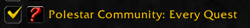
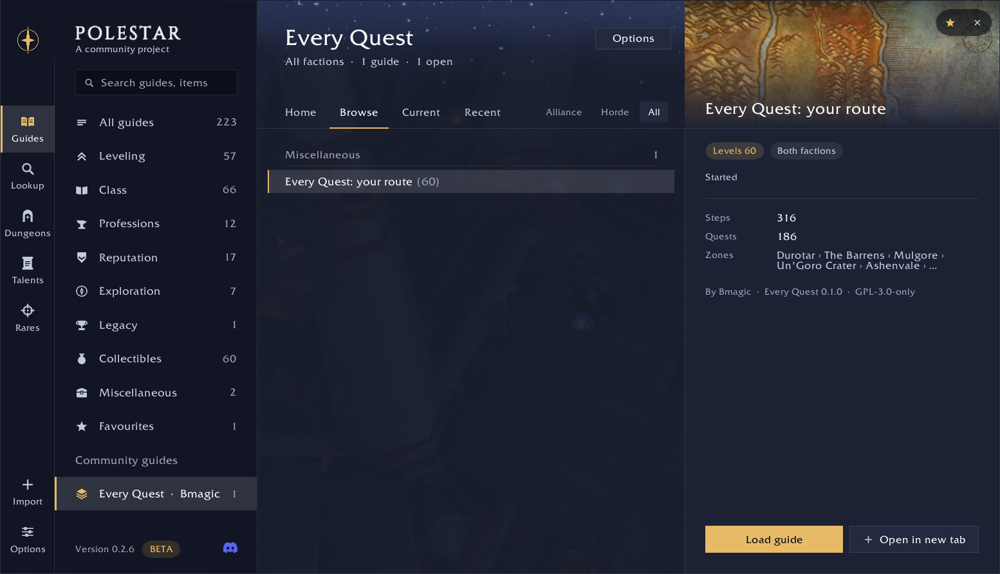
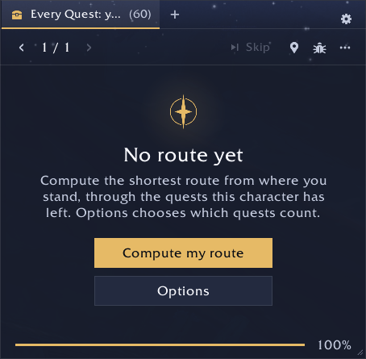
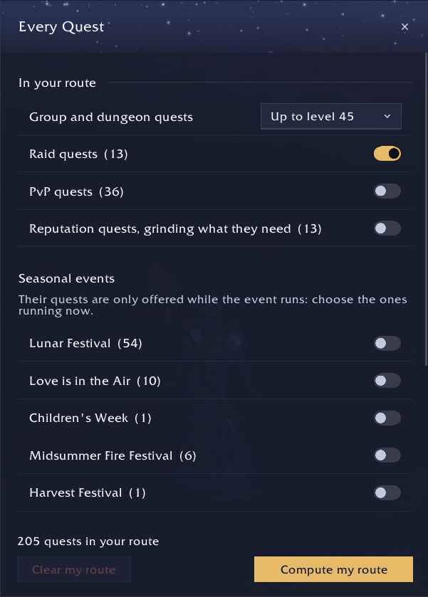
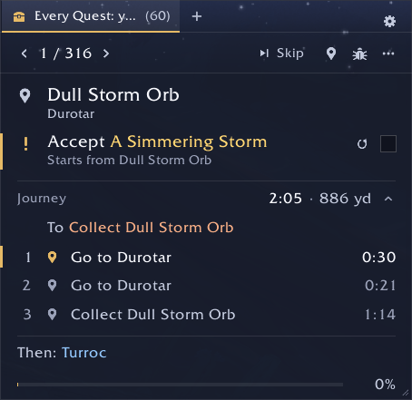
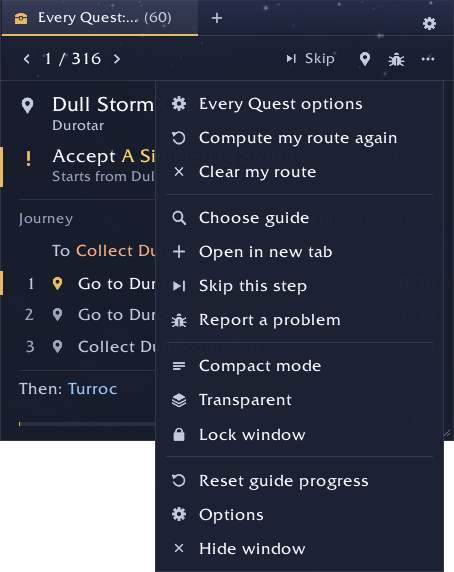

# Every Quest

A community addon for [Polestar](https://github.com/fitzforge/polestar) on World of Warcraft: Forever, by Bmagic. It is
not part of Polestar: report problems in [this repository's issues](https://github.com/bmagic/every-quest/issues), not to
Polestar's authors.

**A completionist addon for level 60 characters.** You reached 60 and left quests behind: Every Quest gets you every one of
them, in the least time. It computes a route for your character, from where you stand and what you have left, and opens it
as a Polestar guide. It keeps quest chains in order, and XP plays no part in it.

**Status:** early version. World of Warcraft: Forever is not out yet, so version 0.1.0 has only been tried on Classic Era
and in Polestar's simulated client. It will be updated when Forever comes out. Until then, expect wrong or missing quests,
and please report them. It covers the Horde and the Alliance. On Classic Era, the route also holds the quests only Forever
has, about 260 for the Horde and 300 for the Alliance: skip those.

## Install

1. Install Polestar. This addon is tested with Polestar 0.2.6 and 0.3.0.
2. Download `PolestarPack_EveryQuest-<version>.zip` from the [Releases page](https://github.com/bmagic/every-quest/releases) and unzip it into the game's
   `Interface/AddOns` folder.
3. Restart the game.
4. On the character screen, open **AddOns** and tick **Polestar Community: Every Quest**, with Polestar itself.

   

## Use

Nothing happens by itself at login. To add the guide, open Polestar's guide menu (`/polestar guides`), choose
**Every Quest** under Community guides, select "Every Quest: your route", then click **Load guide** or
**Open in new tab**.

<p align="center">
  
</p>

The guide window then offers two buttons:

- **Compute my route** computes the shortest route from where you stand. It takes about a minute under a progress bar,
  and you can play meanwhile. The route is saved for this character and opens as a normal Polestar guide.
- **Options** chooses which quests count.

<p align="center">
  
  
</p>

Once computed, the route is a Polestar guide like any other, one step at a time:

<p align="center">
  
</p>

While the route's guide is open, the guide window also has a gear on its tab strip, and three lines at the top of its
menu: the options, computing the route again, and clearing it. This addon's page in Polestar's guide menu has an Options
button too.

<p align="center">
  
</p>

| Command | What it does |
|---|---|
| `/everyquest` | Open the window: choose your quests, then compute your route |
| `/everyquest compute` | Compute your route now, with the choices you made |
| `/everyquest open` | Open the route you already have |
| `/everyquest clear` | Forget the route, and your marks on its steps; your quests are not touched |
| `/everyquest status` | What is left, and what is left out for now |
| `/everyquest group <level>` | The highest quest level of the group and dungeon quests in your route (default 45) |
| `/everyquest seconds <n>` | How long the route may take to compute (default 60) |

## Languages

The interface follows the game's language: English, German, French, Spanish (Spain and Latin America), Brazilian Portuguese,
Russian, Korean and Chinese (Simplified and Traditional). These translations were written by an AI and no native speaker has
checked them yet: corrections are welcome, in `planner/Locale-<locale>.lua`.

## What counts

Always: quests you can do alone. By choice, in the window:

- Dungeon and group quests up to a level (45 by default).
- Raid quests, which take a raid group whatever your level.
- PvP quests.
- Each seasonal event. Their quests are only offered while the event runs, so choose the ones running now.
- Reputation quests. Without this, a quest needing a reputation waits until you have it. With it, after everything else,
  the route asks you to reach each standing, then does the quests it opens, up to the last.

Left out, among others: professions, repeatable quests and Zephras Isle. Each quest has its reason in
[`scope/excluded-horde.json`](scope/excluded-horde.json) and [`scope/excluded-alliance.json`](scope/excluded-alliance.json),
with counts in [`scope/summary-horde.md`](scope/summary-horde.md) and [`scope/summary-alliance.md`](scope/summary-alliance.md).
The `scope/data-gaps-*.json` files list the quests the data knows too little about.

## How it works

[docs/HOW-IT-WORKS.md](docs/HOW-IT-WORKS.md) explains how the addon is built, what data it holds, what it computes in the
game and every link with Polestar.

## Building from source

Most people only need the release zip. Building needs Node 24, Lua 5.1, the game installed, and a
[Polestar](https://github.com/fitzforge/polestar) clone with Forge and these reference data, which are not in that
repository. Polestar's `docs/FORGE.md` explains the commands and their options; `<scratch>` is any folder outside the
clone, so that they leave its tracked files alone.

```sh
# In the Polestar clone, with forge on your PATH (cargo build --release -p forge in its rust/)
export POLESTAR_WOW_DIR="<the game's folder>"
P=~/.local/share/polestar/data-pack
forge data fetch
forge data build --product wowf --questie <QuestieDB checkout> --sources "$P/data/sources" --offline
forge nav grid --out data/local/nav4 --product wowf --defs "$P/data/sources/wowdbdefs"
forge data travel --sources "$P/data/sources" --grid data/local/nav4 --lua <scratch>/TravelData.lua --flight-lua <scratch>/FlightPaths.lua --travel-addon <scratch>/addon
forge data codex --sources "$P/data/sources" --out data/forever/codex --pack <scratch>/codex-pack
forge walks world . data/local/nav4 data/sim horde
forge walks world . data/local/nav4 data/sim alliance
```

Then, in this folder:

```sh
node tools/generate.js ../polestar         # the catalog (guides/catalog) and the list (scope/), from the data
forge guide lint                           # the catalog's goals
polestar playtest                          # the catalog plays to the end, for every race and class
node tools/build.js ../polestar            # the addon, in dist/
```

Never edit `guides/catalog`, which is not in Git: fix the generator or the data. `tools/known-out.json` is the one list
kept by hand: quests the data holds but the game does not offer.

## Tests

```sh
lua5.1 tests/locale.lua                                 # each language holds every text, with the right formats
lua5.1 tests/rules.lua dist/PolestarPack_EveryQuest     # which quests a character is offered, rule by rule
node tests/integration.js ../polestar                   # the real Polestar in its simulated world; --quick for a short run
POLESTAR_ADDON_DIR=<an AddOns folder> node tests/integration.js ../polestar   # against that folder's Polestar

node tools/bench-histories.js ../polestar > tests/histories.lua                # simulated players, on your machine only
lua5.1 tests/bench.lua dist/PolestarPack_EveryQuest tests/histories.lua        # route quality against computing time
BENCH_FACTION=Alliance lua5.1 tests/bench.lua dist/PolestarPack_EveryQuest tests/histories.lua 15 "nothing done"
```

## Releasing

Building needs the game, so GitHub cannot make the zip: you build it, test it and commit it, and the tag publishes it. Raise
`version` in `pack.json`, then:

```sh
node tools/release.js ../polestar          # release/PolestarPack_EveryQuest-<version>.zip
node tools/check-release.js v<version>     # what the tag's workflow will check
git add -A && git commit -m "Every Quest <version>"
git tag v<version>
git push origin main v<version>
```

The workflow checks that the tag matches `pack.json` and that the zip holds the tagged code, then creates the GitHub
release with the zip attached. On CurseForge or Wago, mark Polestar as a required dependency.

Do not use `forge release pack` or `polestar install` here: they build the catalog alone, without the planner.

## Reporting a wrong quest

If the game does not offer a quest the route asks for, tell which one and what you saw. Quests the data holds but the game
does not offer go in `tools/known-out.json`, with who reported them.

## Credits

Every Quest uses the data of [Questie](https://github.com/Questie/Questie) and
[QuestieDB](https://github.com/Questie/QuestieDB), through Polestar's reference data. Thanks to the Questie team and its
contributors.

## Licence

The code is under the [GNU General Public License, version 3](LICENSE), like Polestar. [NOTICE.md](NOTICE.md) says where
the data comes from. A built addon also holds `LICENSE-DATA.txt`, which lists every data source and its licence.

World of Warcraft is a trademark of Blizzard Entertainment, Inc. This project is not affiliated with Blizzard
Entertainment. The screenshots, taken while testing on Classic Era, show the game (© Blizzard Entertainment) and are not
part of the addon.
