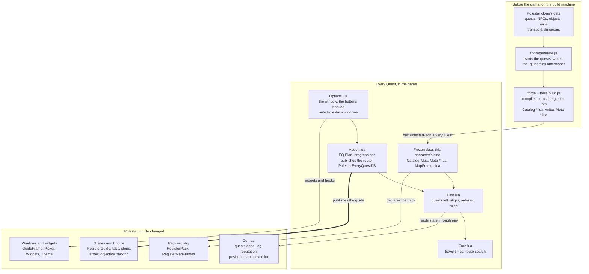

# How Every Quest works

This page explains how the addon is built, what data it holds, what it computes in the game and everything it relies
on in Polestar. For what the addon does for a player, see the [README](../README.md). Figures describe version 0.1.0.

## In short

Every Quest is a completionist addon for level 60 characters: it gets them every quest they did not do while leveling, in
the least time.

The addon has its own database: for each faction, two Lua files generated before the game, a catalog (about 2.5 MiB) and
its metadata (about 0.2 MiB). A character only loads its own side's, and they are read-only in the game.

In the game, the addon computes one thing: the shortest order of stops for this character, from where they stand and
what they have left. It has no guide engine of its own. It writes the result as a Polestar guide, and Polestar does the
rest: the step display, the arrow, objective tracking.

The link with Polestar exists at two moments:

- **Before the game:** Forge compiles the catalog, and the tools read the reference data of a Polestar clone. None of
  those tools reach the player.
- **In the game:** the addon calls `Polestar.RegisterGuide`, reads the character's state through Polestar and hooks its
  windows. No Polestar file is changed.

## Overview

The work on the data happens once, before the game. In the game, the addon only picks an order and hands it to
Polestar.



Arrows run from caller to callee. `Plan.lua` and `Core.lua` never touch the game: they get everything through the `env`
table, which lets the tests run them in plain Lua, without the game or Polestar.

## Before the game: building the database

Two Node scripts build the database: `tools/generate.js` chooses the quests and writes them as guides, `tools/build.js`
compiles them and assembles the addon. They only ever run on the build machine.

1. **Read the data.** `generate.js` reads a Polestar clone: `data/forever/*.json` (quests, NPCs, objects, maps),
   `forever-db/data/*.jsonl`, the dungeon journal in `data/forever/codex/` and Forge's `solo-overrides.json` list.
2. **Sort the quests.** Each quest goes through `reasonOut`, which returns a reason to exclude it, or nothing. A quest
   only reachable through an excluded quest goes too, in a cascade.
3. **Write `.guide` files.** Each kept quest becomes steps: pick-up (`accept`), objectives (`kill`, `collect`,
   `interact`, `goto`), hand-in (`turnin`). At 250 quests a file, that makes 10 files for each faction in
   `guides/catalog/`.
4. **Write `scope/`.** `quests-<faction>.json` and `steps-<faction>.json` feed step 7. The others publish the list:
   `excluded-<faction>.json`, `data-gaps-<faction>.json`, `summary-<faction>.md`.
5. **Compile.** `build.js` runs `forge guide compile`, Polestar's compiler. It writes `Guides.lua`, `Pack.lua`,
   `MapFrames.lua` and the `.toc`.
6. **Divert the guides.** `build.js` replaces every `Polestar.RegisterGuide(` with `PolestarEveryQuestCatalog(` and splits the
   file into `Catalog-Horde.lua` and `Catalog-Alliance.lua`. Polestar therefore never sees these 20 guides: they are only
   data for the planner.
7. **Assemble.** `build.js` writes `Meta-Horde.lua` and `Meta-Alliance.lua`, copies the files of `planner/` and adjusts
   the `.toc`. The result is `dist/PolestarPack_EveryQuest/`.

Going through real guides has one benefit: the catalog passes Polestar's own checks, `forge guide lint` and
`polestar playtest`. Its order (zone, then level, chains respected) means nothing in the game.

### Why a quest is left out

2,283 Horde quests and 2,499 Alliance quests are kept. 1,254 and 1,295 are left out, not counting the other faction's.
PvP, raid, seasonal and group quests stay in the database: they are chosen in the game.

| Reason | How it is detected | Horde | Alliance |
| --- | --- | --- | --- |
| Repeatable | `repeatable` field; kept if another quest needs it | 446 | 453 |
| Profession | `skill` field, or a "Craftsman's Writ" title | 311 | 318 |
| Not a real quest | Title like `<...>`, `[...]`, UNUSED, NYI, DEPRECATED | 126 | 120 |
| Zephras Isle | Giver or hand-in only on continent 2991 | 110 | 106 |
| No giver, no hand-in, or no place | Empty `start` and `end` fields, or an NPC with no position | 80 | 97 |
| Old database only | `source` holds neither `questie-forever` nor `polestar-correction` | 60 | 57 |
| Polestar's list | `solo-overrides.json`, except elites and PvP | 56 | 56 |
| Starting item with no source | No known mob, chest or vendor for the item | 49 | 52 |
| Behind an excluded quest | Excluded prerequisite, in a cascade | 16 | 36 |

`tools/known-out.json` adds quests the game turns out not to offer, by hand, from reports. It is empty for now.

Each quest and its reason: [`scope/excluded-horde.json`](../scope/excluded-horde.json) and
[`scope/excluded-alliance.json`](../scope/excluded-alliance.json).

## The database

The addon has three kinds of data: frozen files, the same for every player, and a save for each character. They are Lua
tables, with no database engine: the game loads them into memory and the planner reads them directly.

| Data | File | Size | What it holds | Written by |
| --- | --- | --- | --- | --- |
| Catalog | `Catalog-Horde.lua`, `Catalog-Alliance.lua` | 2.53 and 2.58 MiB | 6,706 and 7,100 guide steps, in 10 blocks each | `forge guide compile` |
| Metadata | `Meta-Horde.lua`, `Meta-Alliance.lua` | 0.18 and 0.19 MiB | Each quest's record, the step index, the transport network, the factions | `build.js` |
| Maps | `MapFrames.lua` | 4 KiB | The frames that turn a map position into a world position | `forge guide compile` |
| Save | `PolestarEveryQuestDB` | Depends on the route | This character's choices and route | The addon, in the game |

### A step in the catalog

This is Polestar's native guide format, with names and coordinates already resolved by Forge:

```lua
{ title = "{npc:10837}",
  goals = { { t = "turnin", quest = 5238, title = "Mission Accomplished!",
              npc = 10837, npcName = "High Executor Derrington",
              map = 1420, x = 83.13, y = 68.94, z = 60, f = "e" } } }
```

### What `PolestarEveryQuestMeta` holds

| Field | Role |
| --- | --- |
| `build` | Fingerprint of the catalog's steps, to recognise a saved route that no longer applies |
| `quests[id]` | A quest's record: see the next table |
| `steps[guide]` | For each catalog step: its quest and its role, `A` pick-up, `W` objective, `T` hand-in |
| `net` | The network. Horde: 59 points (31 flight masters, 12 docks, 14 lifts, 2 portals), 136 flights, 26 rides. Alliance: 76 points (32, 22, 14, 8), 130 flights, 39 rides |
| `factions`, `repGuides` | The factions quests ask for (13 and 14), and whether Polestar has a reputation guide on each |

A quest's record only keeps what the planner reads:

| Field | Meaning | Horde quests with it | Alliance quests with it |
| --- | --- | --- | --- |
| `kind` | `plain`, `dungeon`, `raid`, `group` or `pvp` | 1,637, 255, 163, 161 and 67 | 1,871, 255, 162, 151 and 60 |
| `maxLevel` | The highest level allowed to take it | 12 | 12 |
| `all` | Prerequisites: all of these | 42 | 41 |
| `any` | Prerequisites: one of these | 1,122 | 1,273 |
| `crumbs` | The breadcrumbs leading to the quest | 79 | 99 |
| `crumbFor` | The quest this breadcrumb announces | 105 | 120 |
| `nextq` | The follow-up: doing it closes this quest | 1,150 | 1,331 |
| `excl` | Mutually exclusive quests | 203 | 193 |
| `reps` | Reputations needed: faction and value | 182 | 185 |
| `event` | Seasonal event | 154 | 152 |
| `tight` | Escort or timed quest, done in one go | 53 | 60 |

Every quest also has its `level`.

### What is saved per character

`PolestarEveryQuestDB` is declared `SavedVariablesPerCharacter` in the `.toc`: the game writes it to disk at logout and on
`/reload`.

| Field | Content |
| --- | --- |
| `groupLevel`, `raid`, `pvp`, `grindRep`, `events`, `seconds` | The window's choices, and the computing time (60 s by default) |
| `route` | The route, as a list of groups of references into the catalog |
| `routeSteps`, `build`, `faction` | The number of steps, the catalog's fingerprint when the route was computed, and the faction |

The route copies no text. A reference is `block number × 65536 + step number`, or `"r:faction:value"` for a reputation
step. That is why a route computed on another catalog is dropped at load: its numbers would point at the wrong steps.

## In the game, step by step

Loading computes nothing. Computing only starts on a click. Once the route is published, Polestar runs it and the addon
stays out of the way.

### When the game loads

1. The game loads Polestar first (`## Dependencies: Polestar`), then the addon's files in `.toc` order.
2. `Pack.lua` declares the pack with `Polestar.RegisterPack`. `MapFrames.lua` gives its map frames with
   `Polestar.RegisterMapFrames`.
3. `Data.lua`, `Core.lua` and `Plan.lua` define the functions. The first line of each `Meta-*.lua` and `Catalog-*.lua`
   file asks `PolestarEveryQuestWants` whether the file is for this character's faction, read from the game or else from the race,
   and the other side's file stops there. When the faction is not known yet, both load, and `EQ.UseFaction` keeps one at
   the first use: that sets `EQ.catalog` and `PolestarEveryQuestMeta`.
4. `Addon.lua` registers the guide `every-quest/route` with a single step, a note. Without a guide when Polestar scans
   the installed addons, the pack would be marked broken and refused from then on.
5. `Options.lua` sets its hooks on Polestar's windows: the button on the pack's page, the gear, the menu, the end panel.
6. At `ADDON_LOADED`, `PolestarEveryQuestDB` can be read. If it holds a route and `build` matches, `restore()` rebuilds the route
   from its references and replaces the guide. Otherwise the route is dropped.
7. At login, Polestar reopens its tabs. The addon asks nothing and computes nothing.

### When the player opens the guide

1. The player picks "Every Quest: your route" in Polestar's guide menu.
2. With no route, the only step is a note: it counts as done at once, and Polestar shows its end-of-guide panel.
3. The hook on that panel replaces the title, the text and the buttons with "No route yet", **Compute my route** and
   **Options**. Other guides keep their panel.

### While computing

1. **Compute my route** calls `EQ.Plan()`, which refuses if a computation is running or the character has no faction yet.
2. `environment()` builds the `env` table: everything the planner will know about the character, read through Polestar.
3. `EQ.BuildInstance(env)` turns the quests left into stops and constraints. With nothing left, the addon says so in the
   chat and stops.
4. `EQ.Solve` runs in a coroutine, resumed each frame by an `OnUpdate`, under the progress bar. **Finish now** keeps the
   best order found. **Cancel** gives up and leaves the old route in place.
5. `EQ.WriteRoute` turns the order into guide steps, copying the catalog's goals. The copy is needed: Polestar rewrites a
   guide's texts in place when it registers it.
6. `publish()` calls `Polestar.RegisterGuide` with the same id, clears Polestar's old marks on that guide, then saves the
   route in `PolestarEveryQuestDB`.
7. `openRoute()` closes and reopens the tab in the same place, because a tab keeps the steps it opened with.

### Once the route is open

Polestar follows the route like any guide: step display, arrow, map pins, moving on as the quest advances. The addon
never recomputes by itself, even if the player leaves the route.

Three events bring the addon back:

- **Computing again:** the guide's menu or the end panel call `EQ.Plan()` again, from the current position.
- **Clearing:** `EQ.ClearRoute()` stops any computation, clears the route and the marks, and puts the guide back to one
  note.
- **Finishing:** when every step is done, the panel shows "Route finished" with the same buttons.

## The computations

The planner looks for the order of stops with the least travel time. It ignores XP, and the time spent on objectives,
which does not depend on the order. With thousands of stops an exact answer is out of reach, so the addon looks for a
very good one in the time it has.

### 1. Which quests are left (`questsLeft`)

Each quest goes through these tests in order, and the first that applies decides:

| Test | Result |
| --- | --- |
| Already done, or not for this race and class | Ignored |
| Raid, not ticked | Left out, even if in the log: the route must not send the player to a raid |
| Quest level 5 or more above the character, red in the game | Left out, even if in the log or if the game lets it be taken |
| Already in the log | Kept, unless a reputation is missing and grinding is off |
| Event not ticked | Left out |
| PvP not ticked | Left out |
| Group or dungeon above the chosen level | Left out |
| Level too low, or above the highest allowed | Left out |
| Reputation missing | Kept if grinding is on, otherwise left out |
| Everything else | Kept |

Three passes then clean up what is kept:

- **Closed quests:** an exclusive already taken, or a follow-up already taken or done, closes the quest for good.
- **Cascade:** a quest with a prerequisite neither done nor kept goes, and so on until nothing changes.
- **Exclusives:** among incompatible quests, an exhaustive search keeps the largest set with no conflict, preferring the
  ones that open the most follow-ups.

### 2. From quests to stops (`assemble`)

A stop is a place to do one thing. A quest gives a pick-up (+1 in the log), a stop for each objective, and a hand-in
(-1). An escort or a timed quest (`tight`) makes a single stop. Two positions in the same cell of a 25-yard grid count as
one place.

The constraints the order must keep:

- The pick-up comes before the objectives, and the objectives before the hand-in.
- The hand-in of `all` prerequisites and `crumbs` breadcrumbs comes before the quest's first step.
- For `any`, if none is done yet, the lowest quest id kept comes first.
- The log never goes above 38 quests. The game allows 40: the margin is for what the player picks up on the way.
- If the data forms a cycle, the links closing it are cut, so that the search can never hang.

### 3. Time between two places (`NewTravel`)

The model comes from Forge (`docs/forge/model.md` in Polestar). A trip takes the shortest of walking straight there and
going through the transport network:

```math
t(a,b) = \min\left( \frac{\text{distance}(a,b) \times \text{detour}}{11.2},\ \min_{n}\left[ \text{via}(a,n) + \text{walk}(n,b) \right] \right)
```

Here `n` runs over the 3 network points nearest to `b`, and `via(a, n)` is the best time from `a` to `n`.

| Parameter | Value |
| --- | --- |
| Mount speed | 7 × 1.6 = 11.2 yards per second |
| Detour | × 1.35 Eastern Kingdoms, × 1.3 Kalimdor, × 1.325 elsewhere |
| Flight | Path length ÷ 30 yards per second, + 20 s |
| Network rides (boats, zeppelins, lifts, portals) | Ride time + average wait, from Forge |
| Short trip | Under 48 s: walking will do, the network is not looked at |
| No known way | 900 s |

The best times between the 59 points are computed at once (Floyd-Warshall). Each place then keeps its time to every
point. Asking "how long from a to b?" then only takes a few additions, so the search can ask a great many times.

### 4. The first route (`Construct`)

From the player's position, the addon always goes to the nearest stop whose constraints are met, if the log allows it. On
equal time, a hand-in goes first: it frees the log and opens follow-ups.

### 5. Improving it (`Improve`)

The search tries two local changes to the order, and keeps only those that save time:

- **Move a block:** a block of 1 to 150 consecutive stops goes next to one of the 12 nearest places.
- **Reverse a block:** up to 64 stops are walked the other way round.

Each try checks the ordering constraints and the log limit. A stop whose neighbours have not changed is not tried again.

When nothing improves any more, the addon shakes the order: 3 random moves, then the improvements again. The result stays
only if the whole route got shorter. The randomness starts from a fixed seed: the search always tries the same shake-ups
in the same order.

### 6. Computing without freezing the game

The search often calls a `tick` function. After 6 ms of work it hands back with `coroutine.yield()`, and `OnUpdate` picks
up at the next frame. The budget is 60 s on the clock, about 20 s of computing at 60 frames per second.
`/everyquest seconds <n>` changes it, from 1 to 600 s.

### 7. Reputations

With grinding on, the route has two parts, so that a long grind holds nothing up:

1. **What can be done now,** with 80% of the computing time.
2. **What waits for a reputation,** and everything that hangs on it, with the rest.

Each standing becomes a stop "Reach Honored with X", with no travel time of its own. Polestar ticks it when the standing
is reached. The standing comes before its quests, and a faction's standings stay in order. Where the chains allow it, a
standing's quests come before grinding the next one, because they give reputation too.

### 8. Writing the route

`WriteSteps` follows the order found and merges consecutive stops at one place into one guide step, with 12 goals at
most. A reputation step stands alone. The result goes to `RegisterGuide`, and its references to `PolestarEveryQuestDB`.

### What it gives

A computed route takes 17 to 45 hours of travel, depending on what the character has done.

| Character (Warrior, group quests up to level 45) | Quests left | First route | Final route |
| --- | --- | --- | --- |
| Human, nothing done | 1,476 | 55.9 h | 44.6 h |
| Orc, nothing done | 1,229 | 52.8 h | 41.1 h |
| Orc, followed all of Polestar's Orc guide | 517 | 25.0 h | 19.3 h |
| Orc, followed 90% of that guide | 654 | 31.6 h | 24.7 h |
| Orc, followed 85% of that guide and 10% of other quests | 654 | 30.3 h | 24.2 h |
| Orc, did 85% of the zones, 90% of their quests | 466 | 20.4 h | 17.5 h |
| Orc, did 60% of the zones, 85% of their quests | 767 | 32.7 h | 26.0 h |

These are the model's hours, measured outside the game in Lua 5.1 with 15 s of computing, not times from the game. In all
7 cases of the last column, no ordering constraint is broken and the log peaks at 38.

On the Human case (4,071 stops, 1,644 places), the list takes 0.04 s, the travel table 0.06 s and the first route 0.28 s.
The rest of the time takes the route from 55.9 h to 44.6 h. With all its data, Lua holds 20 to 50 MiB at the end of a
computation. `tests/bench.lua` measures all this.

## Languages

The interface follows the game's language, in the 9 languages Polestar supports: `deDE`, `esES`, `esMX`, `frFR`, `koKR`,
`ptBR`, `ruRU`, `zhCN` and `zhTW`. A `planner/Locale-<locale>.lua` file holds each one, and any text it lacks shows in English.
The key is the English text, as in Polestar's own files, and only the client's file fills `EQ.L`.

The words come from Polestar's glossary (`data/i18n/glossary`) and the game: standings, faction names and zones are read in
the game at run time. Quest and NPC names in the steps are Polestar's. `tests/locale.lua` checks that each file holds every
text the code uses and keeps its formats. These translations were written by an AI and no native speaker has checked them.

## Every link with Polestar

The addon depends on Polestar both when building and in the game, but only three calls and the `.toc` headers belong to
the official pack format. Everything else leans on Polestar's insides, which may change from one version to the next. It
is tested on versions 0.2.6 and 0.3.0.

### When building

None of this reaches the player, except as the catalogs and the `Meta-*.lua` files.

| In the Polestar clone | Read by | What for |
| --- | --- | --- |
| `rust/target/release/forge guide compile` | `build.js` | Compiling the `.guide` files, writing `Pack.lua`, `MapFrames.lua` and the `.toc` |
| `data/forever/`: `quests`, `npcs`, `objects`, `items`, `map-frames`, `zones` | `generate.js` | Facts about quests and their places |
| `forever-db/data/`: `quest`, `mechanic`, `quest_reward` | `generate.js` | Quest type, escorts and timers, rewards |
| `data/forever/codex/`: `journal`, `npcs` | `generate.js` | Dungeons and raids, instance entrances |
| `rust/crates/forge-world/src/solo-overrides.json` | `generate.js` | The quests Polestar leaves out by hand |
| `data/sim/world-horde.json`, `world-alliance.json` | `build.js` | The transport network of each faction |
| `data/forever/factions.json` | `build.js` | Faction names |
| `guides/forever/reputation/*.guide` | `build.js` | Only whether a faction has a guide, which the reputation step says |

### In the game

The "Status" column says where Polestar describes the item: **Format** for `docs/PACK_FORMAT.md`, the pack contract;
**Internal** for `docs/ARCHITECTURE.md`, described but not promised to packs; **None** if it is described nowhere.

| In Polestar | What the addon does with it | Status | If Polestar changes it |
| --- | --- | --- | --- |
| `.toc` headers `X-Polestar-Pack`, `-Format`, `-Needs` | Being recognised as a pack, Polestar 0.2.5 at least | Format | Addon not recognised |
| `RegisterPack`, `RegisterMapFrames` | Declaring the pack and its map frames | Format | Addon not recognised |
| `RegisterGuide` | Publishing the route's guide, empty or computed | Format | No route |
| `Compat.IsQuestCompleted`, `IsOnQuest` | Which quests are done or in the log | Internal | Computing fails |
| `Compat.GetFactionStanding` | The reputation reached | Internal | Computing fails |
| `Compat.GetPlayerWorldPosition`, `MapToWorld` | The player's position, converting coordinates | Internal | Computing fails |
| `Compat.GetPlayerFaction` | Which side's data this character loads | Internal | The race decides, or no quests |
| `Compat.MapName` | The name of the guide's zone, and of the battlegrounds in the window | Internal | No name or English, harmless |
| `Names.Faction` | A faction's name in the client's language, in a reputation step | None | English name, harmless |
| `Guides.Matches` | Whether a step applies to this race and class | None | Computing fails |
| `Engine.GetTabs`, `OpenTab`, `CloseTab`, `MoveTab`, `SetGuide` | Opening the route, reopening its tab in place | Internal | Route computed but not opened |
| `Engine.GetGuide`, `GetStepIndex`, `GetStepView` | Whether the route is open, and whether it is over | Internal | Hooks do nothing |
| `CharState()`: `manual`, `skipped`, `when`, `pins`, `shapes`, `stepKeys` | Clearing Polestar's marks on the route, and only there | Internal | Marks not cleared |
| `Widgets` (`Button`, `Toggle`, `Dropdown`, `Scroll`, `Confirm`...), `Theme` (`Skin`, `Band`, `Accent`, `Media`) | Building the window and the bar in Polestar's style | Partly: `Theme` and some widgets | Window fails |
| `On`: `GUIDE_CHANGED`, `TABS_CHANGED`, `SETTING_CHANGED` | Showing or hiding the gear | Internal | Hook does nothing |
| `OnInit`, `Get`, `Print`, `RegisterCommand` | Hooking at the right time, reading compact mode, writing to chat, `/polestar everyquest` | Internal, except `Print`: None | Depends |
| `UI.Picker.Render` + `_G.PolestarPicker.Header` | Hook: the **Options** button on the pack's page | Internal, except the frame: None | No button |
| `_G.PolestarGuideFrame` | Hook: the gear on the tab strip | None | No gear |
| `Widgets.ShowMenu` | Replaced: adds 3 lines at the top of the guide's menu | None | No lines |
| `UI.GuideFrame.parts.empty` and its `Primary:Show` | Hook: replacing the end panel on the route | None | The original "Guide complete" panel |
| `UI.GuideFrame.Layout` | Hook: the emblem instead of the check mark, with no route | Internal | Green check mark shown |

The difference between the last two columns comes from the code. Hooks check that each part exists before attaching: if
one goes, only that hook goes, and `/everyquest` still works. `Compat`, `Engine`, `Widgets` and `Theme` are not checked:
if they went, a Lua error would follow.

### What Polestar knows about the addon

To Polestar, this is a community pack holding one guide. It sees neither the catalog, nor the computing, nor
`PolestarEveryQuestDB`. No Polestar file is changed: the hooks are set in memory, at each load.

## Known limits

- **Flights:** every flight path is assumed known. A character who has not found a flight master will take longer than
  planned.
- **Time:** only travel counts. Fights, objectives and reputation grinding are not in the hours announced.
- **Data:** nothing says a quest was removed from the game; only a report does, in `tools/known-out.json`.
  [`scope/data-gaps-horde.json`](../scope/data-gaps-horde.json) and
  [`scope/data-gaps-alliance.json`](../scope/data-gaps-alliance.json) also list 218 and 230 objectives or starting items
  with no source or no place.
- **Recomputing:** the addon never recomputes by itself. A quest skipped by hand comes back at the next computation, and
  below level 60 the quests a higher level opens only come in then.
- **Below level 60:** the addon is made for level 60 characters: its travel model assumes a mount, and its default group
  level assumes a level 60. It still runs below that, without the quests the game shows in red, but the route can cross
  zones too dangerous for the character.
- **Position in an instance:** the game gives none, and the computation then starts from the network's first point: The
  Sepulcher for the Horde, Stormwind for the Alliance.
- **Memory:** the data takes about 13.6 MiB of Lua memory at each login, even with no route (measured outside the game, in
  Lua 5.1). Loading the catalog on demand would avoid that.
- **Coverage:** no Zephras Isle, and a Skyborne character only gets quests once it has a faction.
- **Testing:** World of Warcraft: Forever is not out yet. This early version has been tried on Classic Era with Horde
  characters, and runs against Polestar's simulated client with both factions. The route holds Forever's quests, which
  Classic Era does not have (257 for the Horde, 299 for the Alliance). The addon will be updated when Forever comes out.
